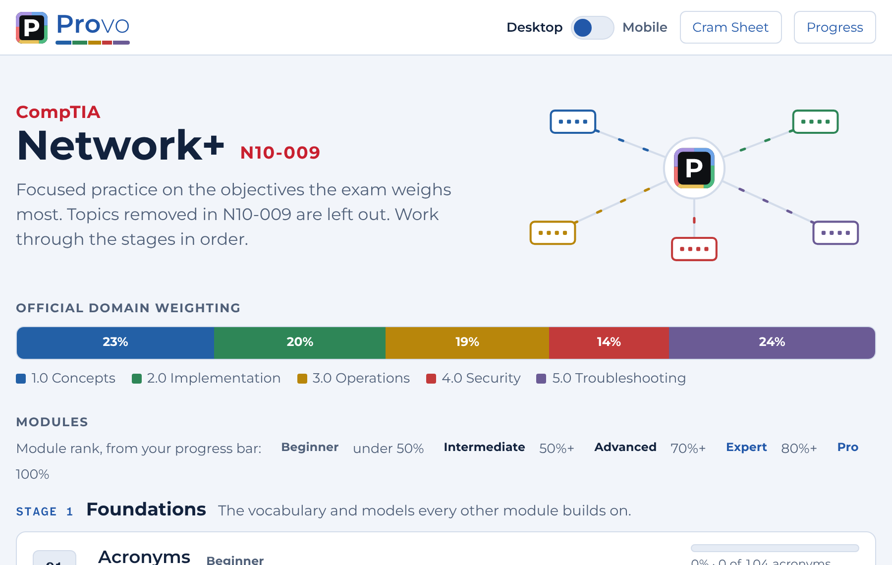
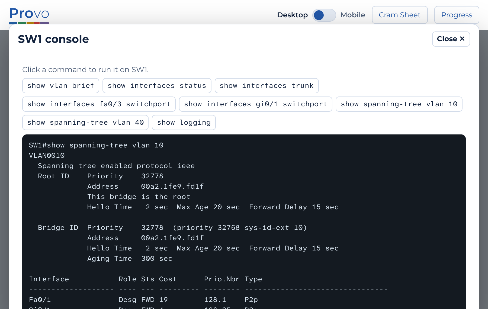
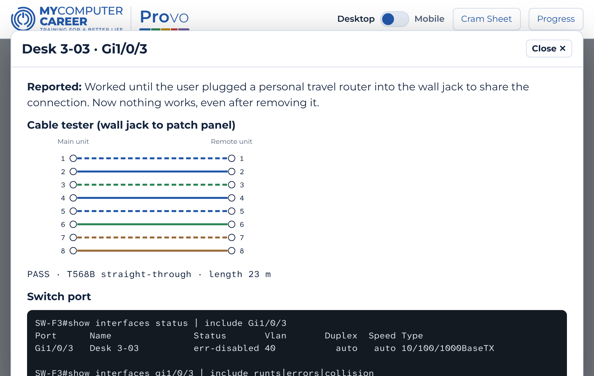
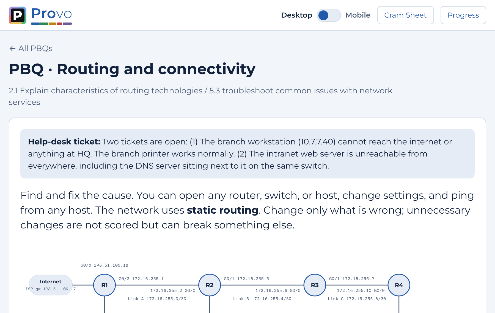
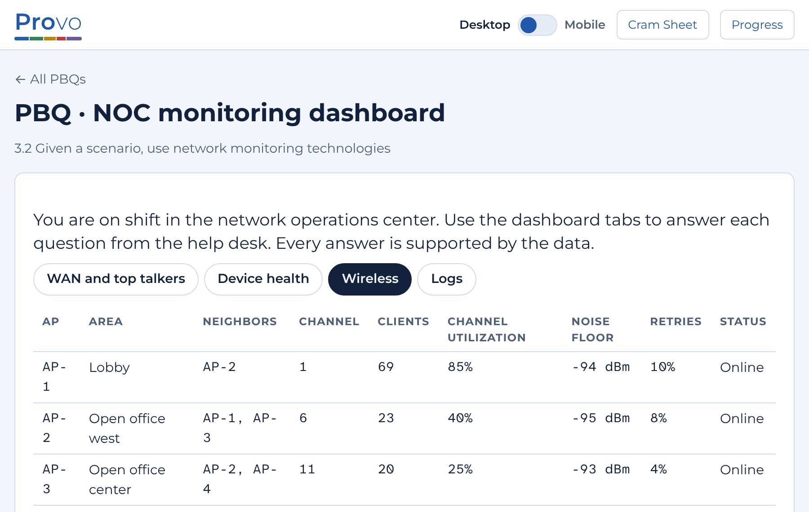
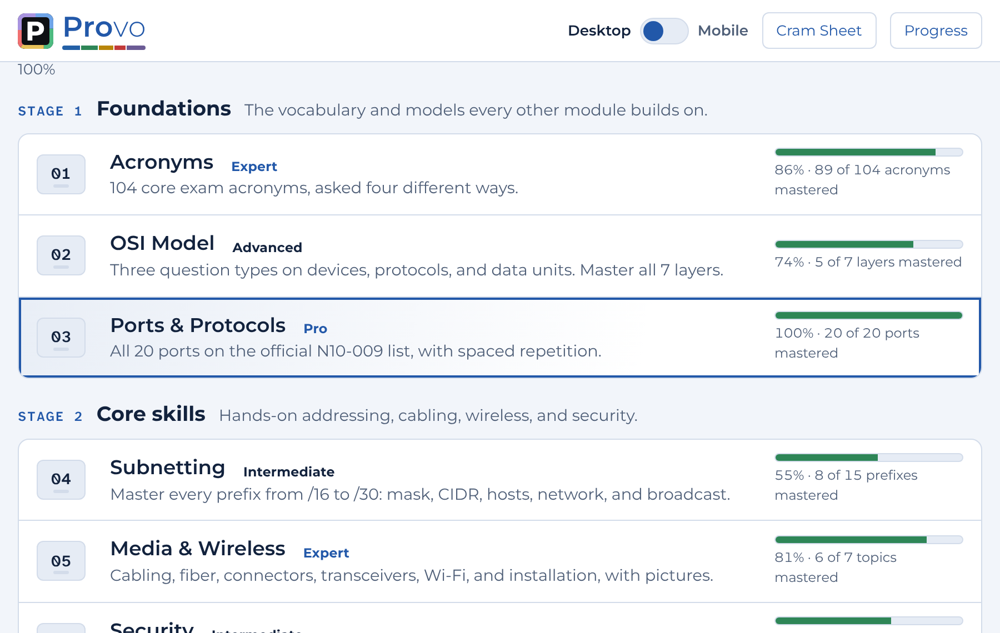
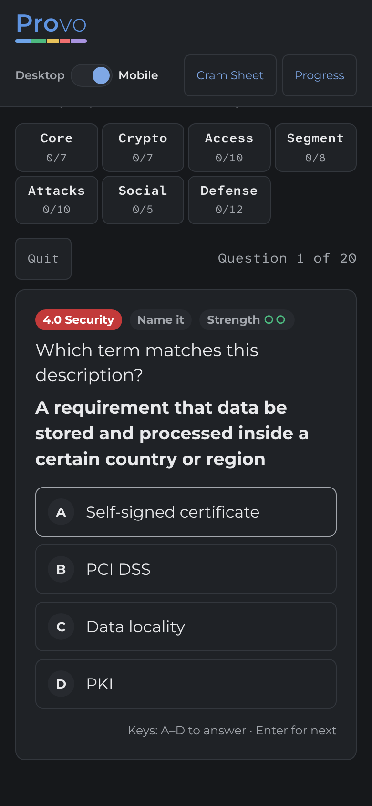

<p align="center"></p>

# Provo by MyComputerCareer

Provo is MyComputerCareer's exam-readiness lab for IT certifications. It turns each exam's official objectives into short drills, hands-on performance-based questions (PBQs), and timed practice exams, and it shows students exactly which topics they have mastered and which still need work.

**[Open Provo →](https://benmhsmith.github.io/Provo/)**

<p align="center"></p>

## About MyComputerCareer

MyComputerCareer (MyCC) trains people for careers in information technology. Its programs take students who are new to IT through industry certifications such as CompTIA A+, Network+, Security+, and CySA+. Its motto is *Training for a better life*.

Provo was built by a MyCC instructor to support that training. It gives students a place to practice between classes and a clear, honest picture of when they are ready to book the exam.

## What Provo does

- **Follows the official objectives.** Every module maps to the exam's published domains, weighted the way the exam weighs them. Topics removed from the current exam version are left out.
- **Builds skills in stages.** Students start with vocabulary (acronyms, ports, the OSI model), move to core skills (subnetting, media, security), then troubleshooting, exam technique, and timed practice exams.
- **Practices the hard questions.** Randomized performance-based questions put students at a switch console, a cable tester, a routing table, a firewall rule set, or a NOC dashboard, the same kinds of tasks the exam asks for.
- **Measures real mastery.** Each module ranks a student from Beginner to Intermediate, Advanced, Expert, and Pro, based on what they have answered correctly over time, not on one lucky run. Reaching Expert in every module earns the Mastery Badge.
- **Uses original content only.** No question is copied from a real exam or a brain dump. Answers are checked against the exam objectives, the relevant standards, or vendor documentation.
- **Keeps progress private.** Progress is saved on the student's own device. Nothing is sent anywhere, and there is no account to create.

## Exams

| Exam | Exam code | Status | Start here |
|---|---|---|---|
| CompTIA Network+ | N10-009 | **Available** | [Provo Network+](certs/network-plus/) |
| CompTIA Security+ | SY0-701 | **Available** | [Provo Security+](certs/security-plus/) |
| CompTIA A+ | Current version when built | Planned | — |

## See it in action

| Hands-on PBQs with real command output | Cable tester wire maps and port diagnostics |
|---|---|
|  |  |
| **Routing tables you build and test** | **A NOC dashboard to read like a pro** |
|  |  |
| **Ranks that show what each student has mastered** | **Works on phones, light or dark** |
|  |  |

## How students use it

Provo runs three ways. Each exam's page has step-by-step setup for all three.

- **In a web browser:** [open Provo](https://benmhsmith.github.io/Provo/). Nothing to install. Works on computers, tablets, and phones. On iPhone, tap Share, then Add to Home Screen.
- **As a single file:** download the `.html` file from the [Releases page](https://github.com/benmhsmith/Provo/releases) and open it, even with no internet.
- **Inside Joplin:** install the `.jpl` plugin from the [Releases page](https://github.com/benmhsmith/Provo/releases), and the lab opens inside the student's [Joplin](https://joplinapp.org/) study notes on desktop or Android.

## For MyCC instructors and staff

- Each exam's folder lists its modules, how ranks are earned, and its [changelog](certs/network-plus/CHANGELOG.md).
- Every version is published on the [Releases page](https://github.com/benmhsmith/Provo/releases).
- To report a wrong answer or suggest a topic, open an [issue](https://github.com/benmhsmith/Provo/issues/new/choose).
- To change content or code, follow [CONTRIBUTING.md](CONTRIBUTING.md).

```
Provo/
├── certs/               ← one folder per exam
│   └── network-plus/    ← Provo Network+: source, Joplin plugin, changelog
├── core/                ← shared engine (planned)
└── docs/                ← the website served by GitHub Pages
```

## License

Copyright (c) 2026 MyComputerCareer. All rights reserved. Provo is proprietary software: the source is visible here, but it is not open source. You may use the official website and release files for your own exam study. See [LICENSE](LICENSE) for the full terms.

Versions up to and including v4.0.0 were released under the GNU GPL v3.0 under earlier names. Third-party parts, such as the embedded fonts, keep their own licenses; see [NOTICE.md](NOTICE.md).

CompTIA, Network+, Security+, A+, and CySA+ are trademarks of CompTIA, Inc. Provo contains no CompTIA exam questions.
