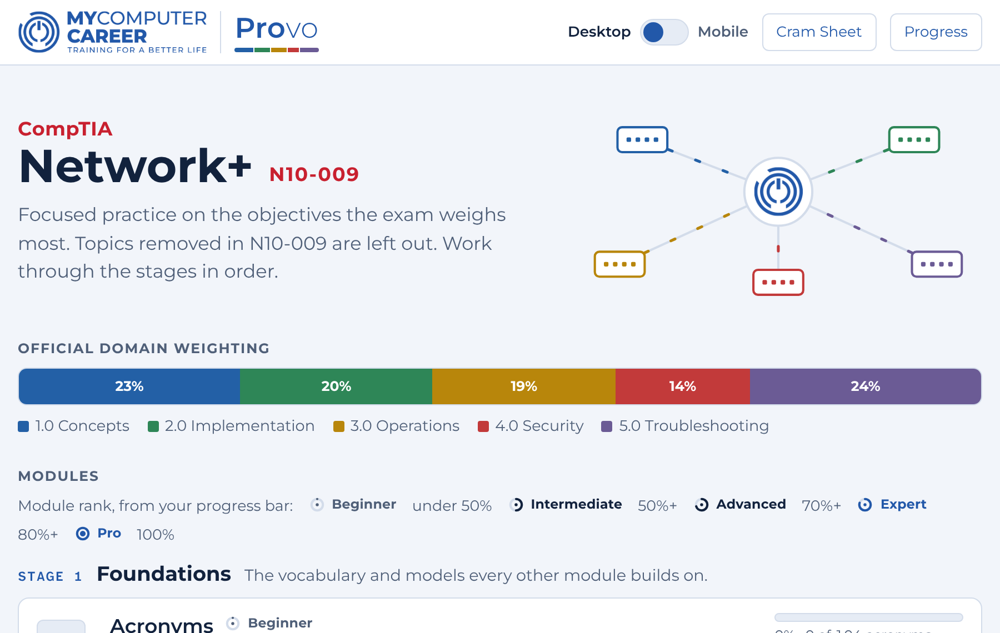
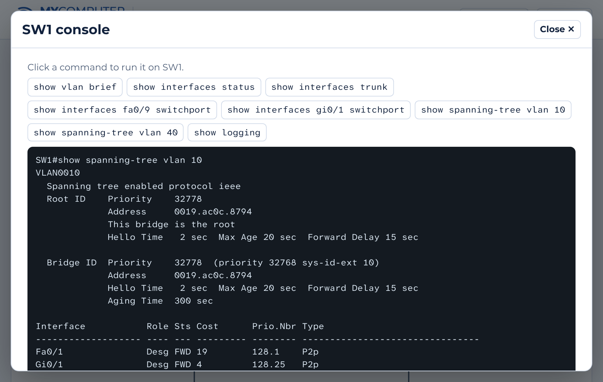
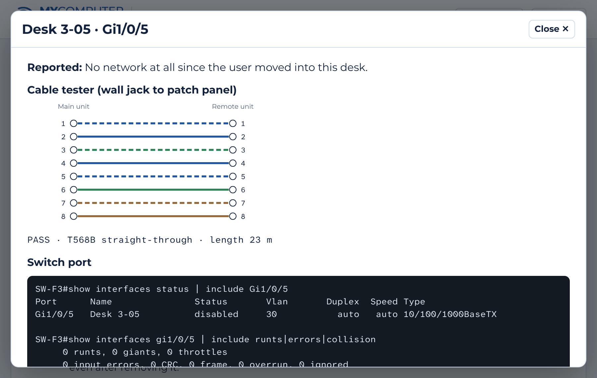
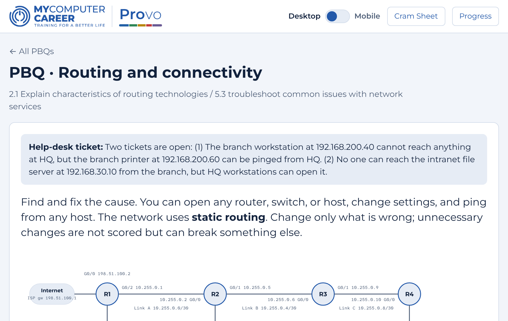
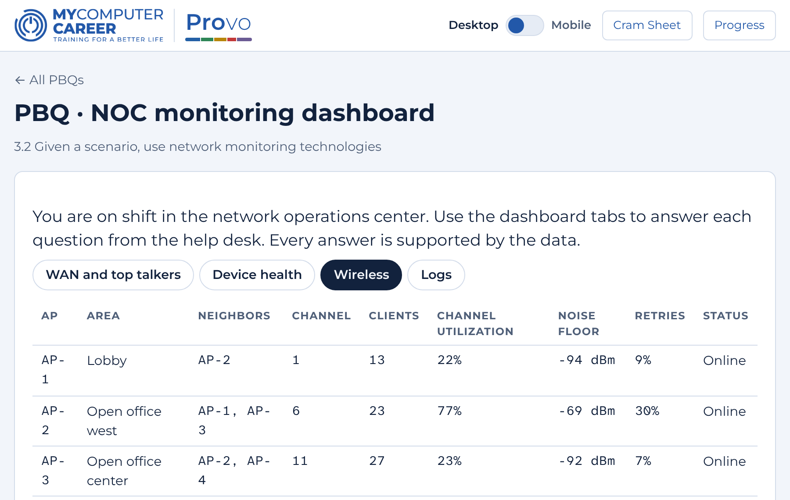
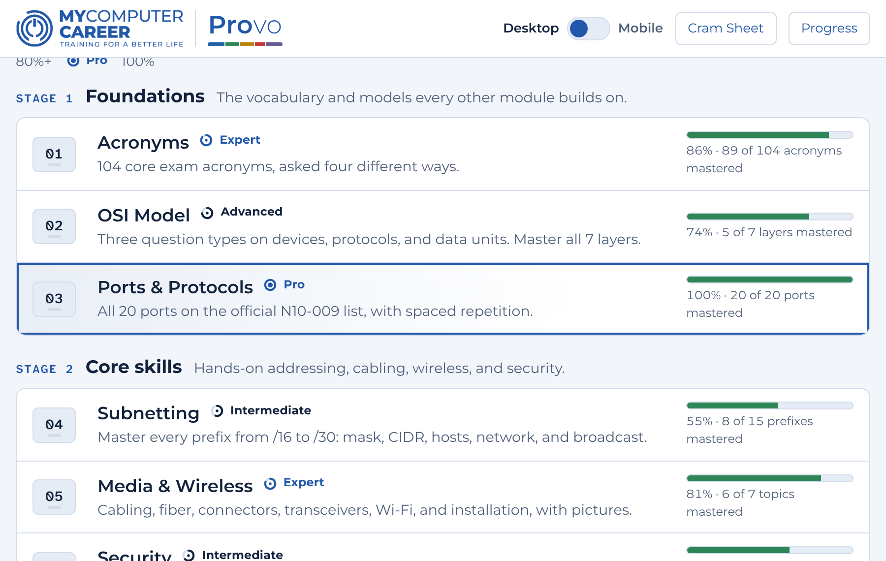
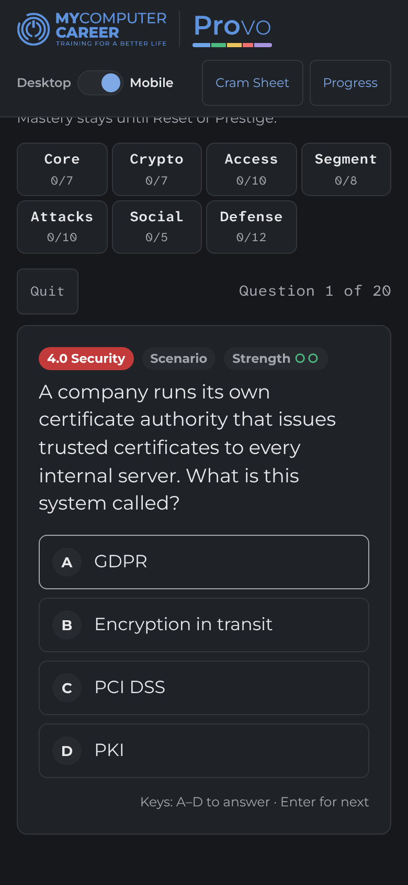

# Provo by MyComputerCareer

Study labs for IT certification exams. Each tool drills the topics an exam actually tests, tracks what you have mastered, and gives you timed practice exams with performance-based questions (PBQs).

Provo works three ways: in your web browser, as a single file you can keep offline, or inside the [Joplin](https://joplinapp.org/) note-taking app on desktop and Android.

**[Open the website →](https://benmhsmith.github.io/Provo/)**

<p align="center"></p>

## Choose your exam

| Exam | Exam code | Status | Start here |
|---|---|---|---|
| CompTIA Network+ | N10-009 | **Available** | [Provo Network+](certs/network-plus/) |
| CompTIA Security+ | Current version when built | Planned | — |
| CompTIA A+ | Current version when built | Planned | — |

## See it in action

| Hands-on PBQs with real command output | Cable tester wire maps and port diagnostics |
|---|---|
|  |  |
| **Routing tables you build and test** | **A NOC dashboard to read like a pro** |
|  |  |
| **Ranks that show what you have actually mastered** | **Works on your phone, light or dark** |
|  |  |

## New to this? Start here

You don't need to know anything about GitHub to use Provo.

1. **Find your exam** in the table above and click its link.
2. **Pick how you want to study.** The exam's page explains each option in plain steps:
   - **In your browser:** nothing to install. Works on computers, tablets, and phones.
   - **As a file:** download one `.html` file and open it, even with no internet.
   - **In Joplin:** install the plugin and the tool opens inside your study notes.
3. **Follow the modules in order.** Each tool is laid out in stages, from vocabulary to full practice exams.

Your progress is saved on your own device. Nothing is sent anywhere.

## Where to download

Every version is published on the [Releases page](https://github.com/benmhsmith/Provo/releases). Each release has:

- `provo-<exam>-vX.Y.Z.jpl`: the Joplin plugin
- `Provo-<Exam>-vX.Y.Z.html`: the standalone web page

## How this repository is organized

```
Provo/
├── README.md            ← you are here
├── certs/               ← one folder per exam
│   └── network-plus/    ← Provo Network+: source, Joplin plugin, changelog
├── core/                ← shared engine (planned; see core/README.md)
└── docs/                ← the website served by GitHub Pages
```

- **Students** only need the exam's page and the Releases page.
- **Instructors** can find each tool's coverage and the changelog in its exam folder.
- **Contributors** should read [CONTRIBUTING.md](CONTRIBUTING.md).

## License

Copyright (c) 2026 MyComputerCareer. All rights reserved. Provo is proprietary software: the source is visible here, but it is not open source. You may use the official website and release files for your own exam study. See [LICENSE](LICENSE) for the full terms.

Versions up to and including v4.0.0 were released under the GNU GPL v3.0 under earlier names. Third-party parts, such as the embedded fonts, keep their own licenses; see [NOTICE.md](NOTICE.md).

CompTIA, Network+, Security+, and A+ are trademarks of CompTIA, Inc. Provo contains no CompTIA exam questions.
