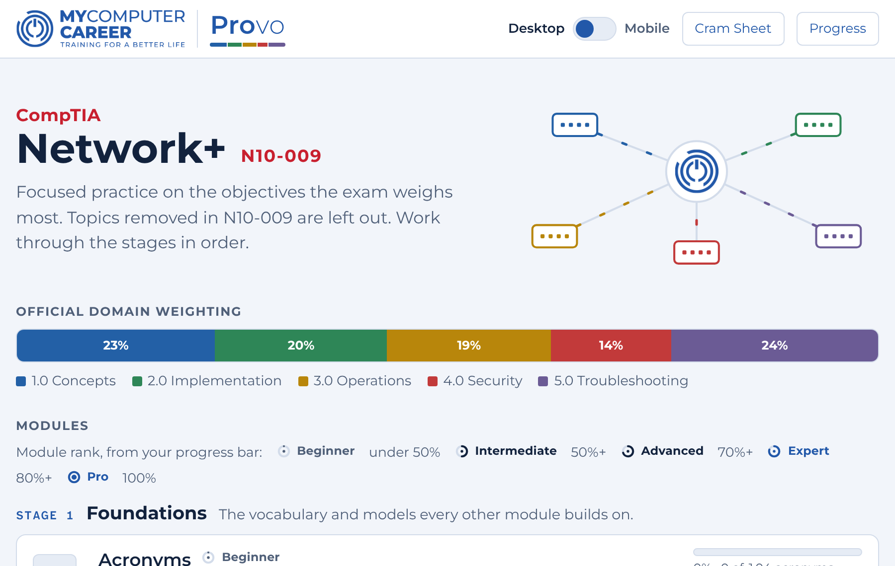
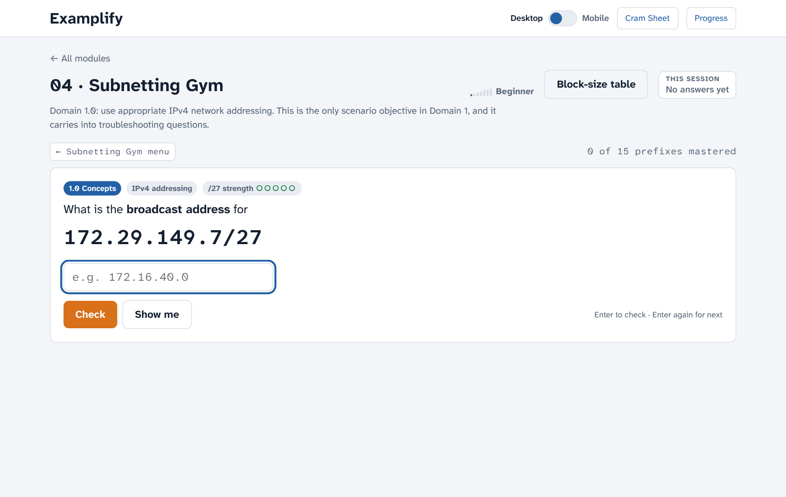
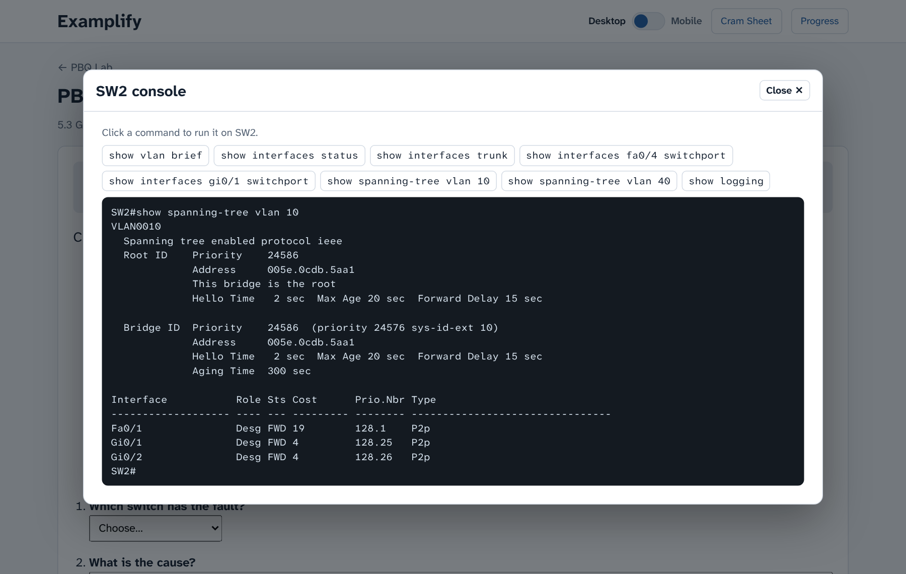
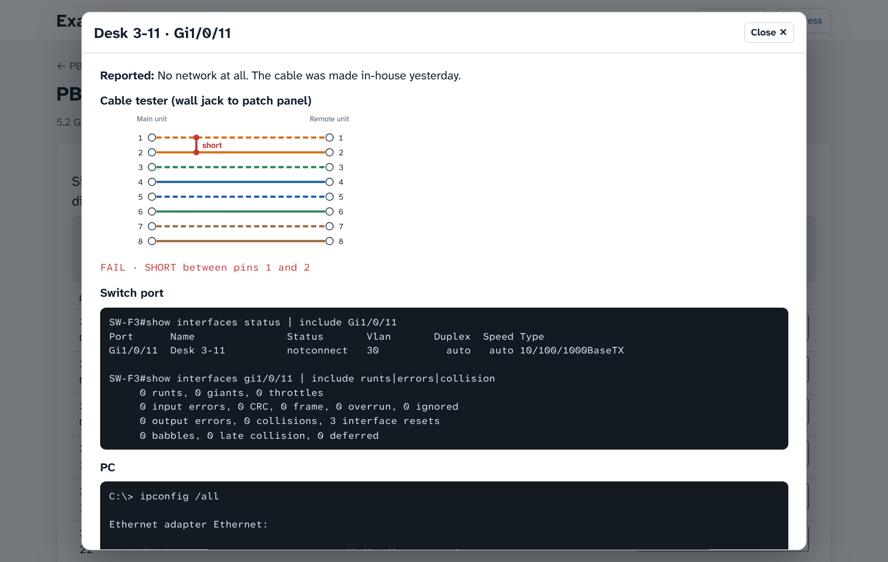
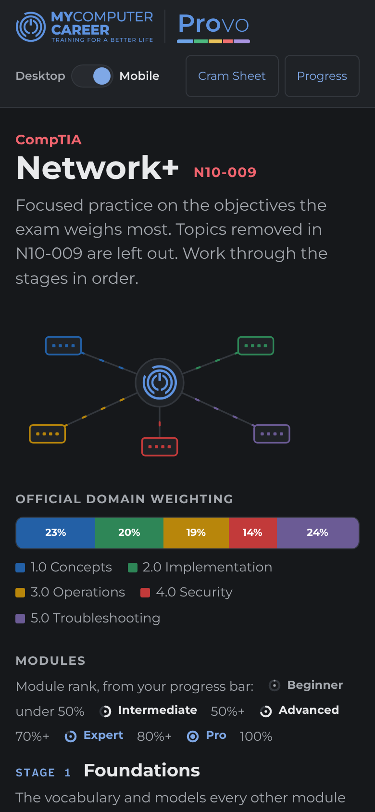

# Examplify Network+

A free study lab for the **CompTIA Network+ N10-009** exam. It drills the topics the exam weighs most, tracks what you have mastered, and finishes with timed mini-exams that include performance-based questions (PBQs).

**Current version:** see the [latest release](https://github.com/benmhsmith/examplify/releases/latest) · [What changed](CHANGELOG.md)

## What's inside

The lab has 11 modules in 5 stages. Work through them in order.

| Stage | Module | What you practice |
|---|---|---|
| 1 · Foundations | 01 Acronym Gym | 104 core exam acronyms, asked four ways |
| | 02 OSI Sorter | Devices, protocols, and data units by layer |
| | 03 Port & Protocol Drill | All 20 ports on the official N10-009 list |
| 2 · Core skills | 04 Subnetting Gym | Every prefix from /16 to /30: mask, CIDR, hosts, network, broadcast |
| | 05 Media & Wireless Match | Cabling, fiber, connectors, transceivers, Wi-Fi, installation |
| | 06 Security Drill | 59 security concepts, attacks, and defenses (Domain 4.0) |
| 3 · Troubleshooting | 07 Troubleshooting Ladder | The 7-step method and what comes next |
| | 08 Which Tool / Command | Hardware tools and CLI commands, with output and pictures |
| 4 · Exam skills | 09 Qualifier Trainer | FIRST, NEXT, BEST, MOST likely, and MINIMUM questions |
| | 10 PBQ Lab | 10 performance-based questions with randomized scenarios |
| 5 · Test | 11 Mini-Exams | Timed exams with PBQs first, weighted to the official domains |

There is also a one-page **Cram Sheet** and a **Progress** page.

Each module gives you a rank from Beginner to Grandmaster based on what you have actually mastered, not on one lucky run. Reach Master in every module to earn the Network+ Mastery Badge.

## Screenshots

<p></p>

| Subnetting Gym | VLAN and trunk PBQ |
|---|---|
|  |  |
| **Cable and port diagnostics PBQ** | **Phone, dark mode** |
|  |  |

## How to use it

Pick whichever fits you. Your progress is saved on your own device and never leaves it.

### Option 1: In your browser (nothing to install)

Open the web version: **https://benmhsmith.github.io/Examplify/network-plus/**

Works on Windows, Mac, Linux, Chromebooks, Android, iPhone, and iPad. Progress is saved in that browser on that device.

**iPhone or iPad:** open the link in Safari, tap the **Share** button, then **Add to Home Screen**. It opens like an app.

### Option 2: As a single file (works offline)

1. Go to the [latest release](https://github.com/benmhsmith/examplify/releases/latest).
2. Download `Examplify-Network-Plus-vX.Y.Z.html`.
3. Double-click it to open it in your browser. No internet needed after that.

### Option 3: Inside Joplin (desktop and Android)

[Joplin](https://joplinapp.org/) is a free note-taking app. The plugin opens the lab right inside a note.

**On a computer (Windows, Mac, Linux):**

1. Download `examplify-network-plus-vX.Y.Z.jpl` from the [latest release](https://github.com/benmhsmith/examplify/releases/latest).
2. In Joplin, open the **Configuration** screen (**Tools → Options** on Windows and Linux, **Joplin → Settings** on Mac) and go to **Plugins**.
3. Click the **Plugin tools** gear button and choose **Install from file**. Pick the `.jpl` file.
4. Restart Joplin when asked. If Joplin keeps running in the system tray, quit it fully first.
5. Open **Tools → Examplify Network+ → How to use** and click **Copy command**. Paste it into any note.

**On Android:**

1. Download the `.jpl` file to your phone.
2. In Joplin, open **Configuration → Plugins**. Under **Advanced settings**, tap **Install from file** and pick the `.jpl` file.
3. Restart the app. Then type ` ```net+ ` on one line of a note and ` ``` ` on the next.

To update, install the newer `.jpl` the same way. Your progress carries over, and the changelog opens after the update.

Joplin on iPhone and iPad only allows plugins from its recommended list, so use Option 1 there.

## For instructors

- Coverage follows the official [N10-009 exam objectives](https://www.comptia.org/en-us/certifications/network/). Topics removed in N10-009 are left out on purpose; the Cram Sheet lists them.
- PBQs are original, randomized scenarios. None are copied from the real exam.
- Every change is recorded in the [changelog](CHANGELOG.md).

## Folder contents (for contributors)

```
network-plus/
├── src/examplify-network-plus.html   ← the whole app: one HTML file (HTML, CSS, JS)
├── joplin-plugin/                    ← Joplin plugin wrapper and build scripts
│   ├── build.py                      ← builds the in-note viewer (dist/nft.js, nft.css)
│   ├── build_editor.py               ← builds the full-width editor view (dist/editor.js)
│   ├── fonts.css                     ← embedded Atkinson Hyperlegible fonts
│   └── dist/                         ← plugin files (index.js, manifest.json, ...)
├── scripts/
│   ├── release.py                    ← builds and versions a release
│   └── mkstand.py                    ← makes the standalone web page
├── CHANGELOG.md
└── UNRELEASED.md                     ← notes for the next release
```

To build a release you need Python 3 and Node.js:

```
python3 certs/network-plus/scripts/release.py 4.1.0
```

This writes the `.jpl` and `.html` into `certs/network-plus/build/` and updates the website copy in `docs/network-plus/`.

---

CompTIA and Network+ are trademarks of CompTIA, Inc. Examplify is not affiliated with or endorsed by CompTIA.
